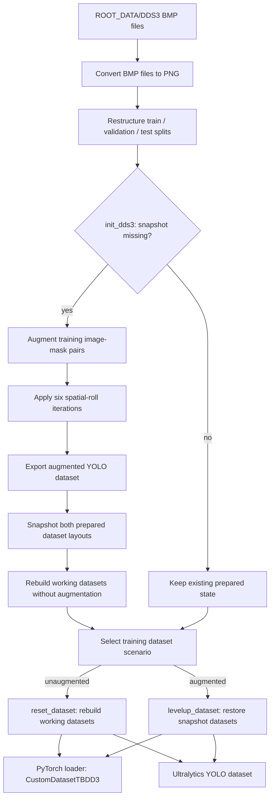

# AFB Segmentation

Research code for detecting and segmenting acid-fast bacilli (AFB) in
microscopy images. The project contains a DDS3 data pipeline, YOLO instance
segmentation, distance-guided image filtering, an Attention U-Net mask-refinement
model, and experiment scripts for model tuning, spatial-bias analysis, and
inference benchmarking.

The installable package is `afb-segmentation`; Python imports use
`afb_segmentation`. Research workflows live separately in `experiments/`.

> **Model download required:** Trained model weights are not included in a
> repository clone. [Download the model archive from Google Drive](https://drive.google.com/file/d/1Xuy3VppsPMXnCZeMW0zXb8-Fst7mUmRe/view?usp=sharing)
> before running workflows that load saved checkpoints. See the
> [model setup instructions](artifacts/models/README.md) for extraction paths.

## Repository layout

- `src/afb_segmentation/data_pipeline/` prepares, converts, augments, and loads
  image and mask data.
- `src/afb_segmentation/models/` contains model architectures, training,
  evaluation, and inference code.
- `src/afb_segmentation/utils/` contains shared helpers and visualization code.
- `experiments/` contains repository-level tuning, analysis, and diagnostic
  workflows, generated trial CSVs, and local analysis outputs.
- `docs/code/` documents the package and experiment structure. The manuscript
  source is under `docs/paper/my-paper/latex/`.
- `artifacts/` is the local dataset and primary model output directory. Dataset
  and model files are ignored by Git; directory placeholders and model download
  instructions are included in repository clones.

See the [experiment guide](docs/code/experiments.md), [model guide](docs/code/models.md),
[data-pipeline guide](docs/code/data_pipeline.md), and
[shared utility guide](docs/code/utils.md) for implementation details.

## Environment setup

The project declares Python `>3.12` in [pyproject.toml](pyproject.toml).
With Poetry installed, run these commands from the repository root in a new
checkout:

```bash
poetry install
cp .env.example .env
cp src/afb_segmentation/models/config.example.yml src/afb_segmentation/models/config.yml
```

Keep existing local configuration files if you have already configured the
project. Both `.env` and `models/config.yml` are ignored by Git.

Set the paths in `.env` to match your local files:

| Variable | Example value | Purpose |
| --- | --- | --- |
| `ROOT_PROJECT` | `.` | Repository root; run commands from this directory. |
| `ROOT_DATA` | `artifacts/dataset` | Parent directory for raw DDS3 and prepared datasets. |
| `ROOT_SNAPSHOT_DATA` | `artifacts/dataset/snapshots` | Saved augmented dataset layouts. |
| `ROOT_MODELS` | `artifacts/models` | Model checkpoints and training/evaluation outputs. |

Place the DDS3 source files under `ROOT_DATA/DDS3`, retaining the original
`TRAINING SET`, `VALIDATION SET`, and `TEST SET` directories and their category
subdirectories containing `IMAGE` and `MASK` folders. Dataset files and trained
weights are not included in repository clones.

Review `src/afb_segmentation/models/config.yml` before training: choose devices
available on your machine and set the U-Net YOLO-checkpoint paths to existing
weights. The example references `yolo11l-seg` checkpoints, while its YOLO model
list contains n/s/m variants; those settings do not automatically provide the
weights required by U-Net. The example is a starting configuration, not a
record of every reported experiment.

## Data-pipeline workflow

The pipeline turns raw DDS3 BMPs into prepared PyTorch and YOLO datasets, then
lets training select either the augmented or unaugmented version:



`DatasetManager.init_dds3()` creates the augmented snapshot only when its
snapshot directory is absent. `reset_dataset()` rebuilds the unaugmented
working datasets; `levelup_dataset()` replaces them with the saved augmented
snapshot. `CustomDatasetTBDD3` uses YOLO to filter each input image and returns
the filename-matched original mask as its target. The YOLO export contains
polygon labels for Ultralytics training.

Dataset initialization, reset, augmentation, and spatial-bias operations can
write or delete data. The augmentation and spatial rolls use unseeded random
operations, so identical generated files are not guaranteed across runs. See
the detailed [data-pipeline guide](docs/code/data_pipeline.md) and its
[preservation notes](src/afb_segmentation/data_pipeline/AGENTS.md) before
changing or running these operations.

## Research workflows

Run modules from the repository root through the Poetry environment.
Model inspection loads the n/s/m YOLO segmentation variants and prints their
model information; Ultralytics may download pretrained weights:

```bash
poetry run python -m experiments.diagnostics.model_stats
```

The tuning entry points below launch training and write trial outputs. The
U-Net search needs prepared validation data and a saved augmented-data
`yolo11l-seg` checkpoint; it selects CUDA when available and otherwise MPS.
The YOLO search resets the working dataset before its first trial.

```bash
poetry run python -m experiments.tuning.unet
poetry run python -m experiments.tuning.yolo
```

**YOLO configuration caveat:** the tuning script currently reads top-level
`models`, `imgsz`, `device`, and `seed` keys, while the example nests these under
`yolo`. The configured YOLO trainer expects a single model value at
`yolo.models` and a `yolo.warmup_epochs` setting, whereas the example supplies a
model list and omits that setting. Review the selected workflow's configuration
accesses before launching it; copying the example alone does not resolve these
differences.

The spatial-bias workflow resets and rebuilds the working DDS3 dataset, writes
augmented samples, and overwrites training image and mask pairs. Run it only
when those dataset changes are intended:

```bash
poetry run python -m experiments.analysis.spatial_bias
```

To benchmark saved model components on CPU and CUDA, use a new output directory:

```bash
poetry run python -m experiments.diagnostics.pipeline_benchmark --output-dir experiments/analysis/benchmark_new
```

The benchmark requires CUDA, saved augmented-data YOLO and U-Net checkpoints,
and existing DDS3 test images at the paths defined in the script. It measures
single-pass and ten-pass MC-dropout refinement, records input hashes, timings,
and memory use, and does not train models or modify the dataset. See the
[experiment guide](docs/code/experiments.md) for timing scope and prerequisites.

## Interpretation and current limitations

- The standalone inference `Pipeline` currently imports an undefined
  `MaskRefiner` and cannot be used as a working inference entry point. The
  benchmark composes the model components directly.
- Ultralytics box/mask metrics and the custom connected-component metrics are
  different evaluations. The custom instance AP is a precision-based
  approximation, not confidence-ranked standard AP.
- The U-Net trainer currently selects checkpoints using decreasing validation
  F1. Consult the [model guide](docs/code/models.md) before interpreting saved
  checkpoints or comparing runs.
- Manuscript numbers describe specific historical runs. Match their
  configurations and saved outputs before treating a current run as a
  reproduction; local artifacts may come from earlier configurations.

## Generated artifacts

Trial CSVs are written directly under `experiments/`; analysis outputs live
under `experiments/analysis/`. Generated CSVs and named run directories are
ignored by Git. Existing outputs were relocated from `artifacts/experiments/`
and `artifacts/analysis/`; paths recorded inside historical run manifests and
reports retain their original values.

The main output paths and their current writers are:

| Output | Writer |
| --- | --- |
| `experiments/spatial_entropy_analysis.csv` | `experiments/analysis/spatial_bias.py` |
| `experiments/unet_trials.csv` | `experiments/tuning/unet.py` |
| `experiments/<model>_trials.csv` | `experiments/tuning/yolo.py` |
| `artifacts/runs/segment/` | Per-trial YOLO training runs from `experiments/tuning/yolo.py` |
| `artifacts/models/optuna_results/` | YOLO validation outputs from `experiments/tuning/yolo.py` |
| `artifacts/models/<model> - <augmentation>/` | YOLO checkpoints, train/validation outputs, and test metrics from `afb_segmentation.models.training.yolo_trainer` |
| `artifacts/models/unet/{with_augmentation,without_augmentation}/` | U-Net checkpoints and training history from `afb_segmentation.models.training.unet_trainer`; uncertainty CSVs from `afb_segmentation.models.evaluation.uncertainty`; test metrics from `afb_segmentation.models.evaluation.unet` |

These paths depend on `ROOT_PROJECT` and `ROOT_MODELS` where noted. Existing
files in `artifacts/` may have been produced with earlier configurations. For
example, the current YOLO tuning config lists n/s/m variants, while an l-variant
trial CSV is also present.

Two existing layouts do not have a current writer identified in the source:
`artifacts/experimental_models/models/results/` is referenced as an inference
path by `afb_segmentation.models.inference.pipeline`, and
`artifacts/models/results/unet/` does not match the current U-Net trainer output
layout. Treat files in those locations as outputs from an older or external
workflow until their provenance is confirmed.
